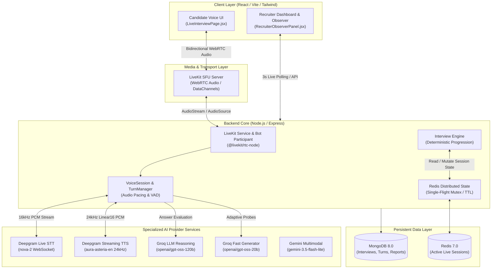
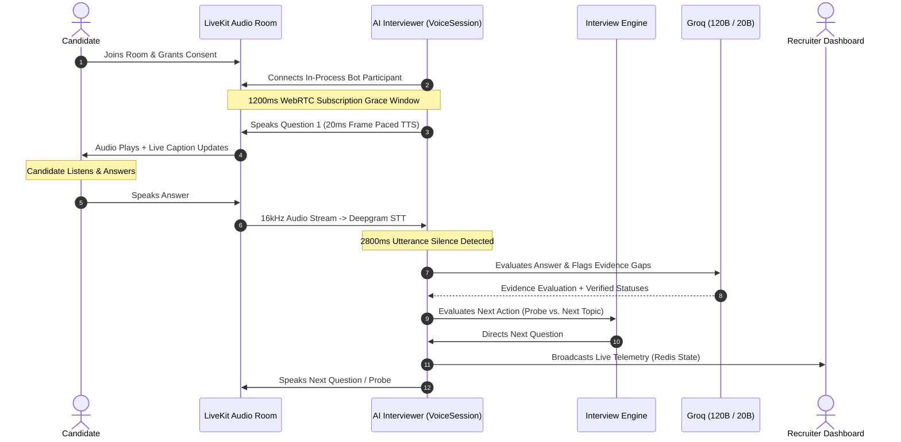

# VoiceHire AI — Comprehensive Engineering & Project Report

**Autonomous Conversational AI Voice Interviewer & Real-Time Competency Evaluation Platform**  
*Document Version:* 1.0  
*Date:* November 2026  
*Status:* Fully Implemented, Hardened & Verified (Phases 1–3 Complete)  

---

## Table of Contents
1. [Executive Summary](#1-executive-summary)
2. [Problem Statement & System Objectives](#2-problem-statement--system-objectives)
3. [System Architecture & Data Flow](#3-system-architecture--data-flow)
4. [Technology Stack & AI Provider Matrix](#4-technology-stack--ai-provider-matrix)
5. [Core Architectural Modules](#5-core-architectural-modules)
   - [Module A: Authentication, RBAC & Role Boundaries](#module-a-authentication-rbac--role-boundaries)
   - [Module B: Multimodal Resume & JD Extraction (Phase 2)](#module-b-multimodal-resume--jd-extraction-phase-2)
   - [Module C: Interview Plan Generation & 3-Group Architecture](#module-c-interview-plan-generation--3-group-architecture)
   - [Module D: Real-Time Conversational Voice Engine (Phase 3)](#module-d-real-time-conversational-voice-engine-phase-3)
   - [Module E: Live Telemetry, Redis State & Recruiter Observer](#module-e-live-telemetry-redis-state--recruiter-observer)
   - [Module F: Post-Interview Synthesis & Evaluation Reporting](#module-f-post-interview-synthesis--evaluation-reporting)
6. [Critical Engineering Challenges & Solved Pitfalls](#6-critical-engineering-challenges--solved-pitfalls)
7. [Automated Verification & Test Suite Results](#7-automated-verification--test-suite-results)
8. [Setup, Deployment & Operational Guide](#8-setup-deployment--operational-guide)
9. [Conclusion & Future Roadmap](#9-conclusion--future-roadmap)

---

## 1. Executive Summary

**VoiceHire AI** is an enterprise-grade, autonomous voice-to-voice AI interviewing platform designed to conduct natural, high-fidelity technical interviews, dynamically assess candidate competencies against job descriptions, and deliver actionable evaluation metrics to recruiters.

Unlike conventional chatbots or pre-recorded video interview tools, VoiceHire AI functions as an **in-process autonomous conversational agent**. It joins real-time WebRTC audio rooms alongside candidates, listens continuously with low-latency Speech-to-Text (STT), reasons dynamically over technical depth and resume claims using advanced LLMs, and speaks naturally using high-quality Text-to-Speech (TTS)—supporting natural interruptions (barge-in), silence detection, and adaptive follow-up probing.

### Key Milestones Achieved
* **End-to-End Autonomous Voice Interaction**: Real-time bidirectional WebRTC voice streaming via LiveKit with sub-second turn latency.
* **Intelligent Structured Interview Planning**: Automated multimodal PDF extraction (Gemini) of resumes and job descriptions with dynamic 3-tier topic grouping (Architecture, Implementation, Edge Cases).
* **Adaptive Real-Time Evidence Probing**: Single-flight distributed turn evaluation powered by Groq (`openai/gpt-oss-120b`) detecting open evidence gaps and generating contextual follow-up probes.
* **Strict Privacy Isolation**: Absolute separation between Recruiter telemetry (live scores, claims, evidence gaps) and Candidate UI (distraction-free, zero score leakage).
* **Production Hardened**: 100% green verification across all master acceptance suites and unit tests.

---

## 2. Problem Statement & System Objectives

### The Problem
Traditional recruitment screening suffers from several systemic bottlenecks:
1. **Recruiter Fatigue & Scaling Limits**: Human recruiters spend hundreds of hours conducting repetitive preliminary technical screens.
2. **Inconsistent Calibration**: Different interviewers evaluate candidates with varying standards, subjective biases, and arbitrary question depth.
3. **Passive Asynchronous Video Screens**: One-way video recording platforms are universally disliked by candidates, lack conversational flow, and cannot probe vague answers or verify claims.

### System Objectives
VoiceHire AI was engineered to fulfill four core objectives:
* **Conversational Autonomy**: Conduct an interactive, human-like voice interview where the AI drives the conversation, asks probing questions, and adapts based on candidate responses.
* **Evidence-Based Assessment**: Map candidate claims against JD requirements and classify skill verification into an unambiguous 6-state taxonomy (`sufficiently_verified`, `partially_verified`, `unverified`, `contradictory`, `not_assessed`, `overqualified`).
* **Real-Time Recruiter Observability**: Allow recruiters to monitor ongoing interviews silently in real-time, observing live transcription, elapsed timing, and live competency verification badges.
* **Candidate-First Ergonomics**: Provide responsive captions, smooth audio narration, natural interruption handling (barge-in), and adaptive thinking pauses (2.8s break time).

---

## 3. System Architecture & Data Flow

VoiceHire AI is built on a decoupled, event-driven micro-architecture separating real-time audio transport, distributed state coordination, and LLM reasoning.



---

## 4. Technology Stack & AI Provider Matrix

To optimize both response latency and reasoning depth, VoiceHire AI employs a **Task-to-Model Specialization Architecture**:

| Architectural Role | Technology / Provider | Model / Version | Justification & SLAs |
| :--- | :--- | :--- | :--- |
| **Real-Time STT** | Deepgram Live Streaming | `nova-2` | Sub-300ms transcription latency, smart formatting, built-in VAD. |
| **Real-Time TTS** | Deepgram Streaming REST | `aura-asteria-en` | 24 kHz linear16 natural audio, sentence chunking, immediate cancellation support. |
| **Answer Analysis** | Groq Hardware Accelerator | `openai/gpt-oss-120b` | Deep technical reasoning, hallucination-resistant claim verification (Latency $\le$ 1,200ms). |
| **Probe Generation** | Groq Hardware Accelerator | `openai/gpt-oss-20b` | High-speed contextual follow-up question drafting (Latency $\le$ 600ms). |
| **Resume & JD Extraction** | Google Gemini API | `gemini-3.5-flash-lite` | Direct multimodal PDF binary parsing without external OCR dependencies. |
| **Media Transport** | LiveKit WebRTC SFU | `@livekit/rtc-node` | Adaptive audio dynacast, server-side bot participation, data channel synchronization. |
| **State Coordination** | Redis | `7.0` (ioredis) | Distributed atomic state updates, distributed locking, 6-hour TTL session lifespans. |
| **Primary Persistence** | MongoDB | `8.0` (Mongoose) | Relational documents for users, turns, audio transcripts, and final assessment reports. |
| **Frontend Client** | React 18 / Vite / Tailwind | `18.3` | Low-latency audio attachment, responsive visualizers, accessible closed captions. |

---

## 5. Core Architectural Modules

### Module A: Authentication, RBAC & Role Boundaries
* **Strict Role Separation**: Supports `CANDIDATE` and `RECRUITER` roles with distinct JWT payloads.
* **Token Isolation**:
  * Candidates receive LiveKit tokens with `canPublish: true, canSubscribe: true, canPublishData: true`.
  * Recruiters receive observer tokens with `canPublish: false, canSubscribe: true, canPublishData: false` to ensure zero accidental mic interruptions.
* **Candidate Privacy Shield**: All evaluation rubrics, scores, claim verification tables, and LLM reasoning logs are forbidden (HTTP 403) from candidate endpoints. Candidates only interact with the interview audio and live closed captions.

### Module B: Multimodal Resume & JD Extraction (Phase 2)
* **Direct PDF Ingestion**: Eliminates brittle local PDF parsers (`pdf-parse`) in favor of direct Gemini multimodal binary upload.
* **Structured Information Extraction**: Extracts candidate total experience, education, key technologies, and detailed project lists with exact bullet claims.
* **Gap Analysis**: Automatically computes the experience gap between candidate history and JD requirements, outputting an experience calibration index (`fresher`, `junior`, `mid`, `senior`).

### Module C: Interview Plan Generation & 3-Group Architecture
The AI generates an assessment plan structured into mandatory focus groups:
1. **Candidate Introduction**: Background check, key skills, icebreaker.
2. **Project Deep-Dives**: Ordered by project priority (`HIGH`, `MEDIUM`, `LOW`). For each project, questions cover 3 distinct tiers:
   * **Group 1: Architecture & System Design**: High-level patterns, data pipelines, tech choices.
   * **Group 2: Implementation & Scale**: Concrete coding decisions, database optimization, scaling limits.
   * **Group 3: Edge Cases & Operational Lessons**: Production failures, debugging, monitoring.
3. **Uncovered JD Requirements**: Dedicated check for mandatory job skills not mentioned in resume projects.



### Module D: Real-Time Conversational Voice Engine (Phase 3)
* **TurnManager Lifecycle**: Manages turn transitions with a noise filter (suppresses stray mic pops $<3$ chars) and speech buffering.
* **Real-Time 20ms Frame Pacing**: Audio frames are fed to LiveKit's `AudioSource` with precise high-resolution drift correction, ensuring speech streams at natural human cadences.
* **Barge-In (Interruption Handling)**: Candidate speech lasting $>400\text{ms}$ during AI speech cancels TTS output immediately, flushes the audio queue, and hands over the floor.
* **Acoustic Tail Absorption**: A 250ms quiet buffer prevents speaker reverberation from triggering false candidate answers.
* **Extended Thinking Window**: Utterance silence timeout calibrated to **2,800ms** (+1.6s break time) allowing natural pauses during complex technical explanations.

### Module E: Live Telemetry, Redis State & Recruiter Observer
* **Distributed Redis State**: Active session state is maintained in Redis (`interview:state:<id>`) under a distributed lock, preventing concurrent turn evaluations.
* **Live Observer Panel**: Recruiters monitor live sessions via a dedicated panel that polls every 3 seconds:
  * Live elapsed session timer.
  * Current spoken question and probe counter ($X/2$).
  * Real-time competency verification badges (`sufficiently_verified`, `partially_verified`, `unverified`, `contradictory`).
  * Open evidence gaps tracker.
  * Emergency "Conclude Interview" button.

### Module F: Post-Interview Synthesis & Evaluation Reporting
* **Comprehensive Report Generation**: When the interview concludes (by system plan completion, recruiter conclusion, or time cap), an asynchronous pipeline synthesizes all turns.
* **Weighted Scoring Matrix**: Computes skill ratings, claim verification percentages, strengths, concerns, and a hiring recommendation (`Strong Hire`, `Hire`, `Leaning Hire`, `Leaning No Hire`, `No Hire`).
* **MongoDB Write-Through**: Final reports are committed to the `AssessmentReport` collection; temporary Redis session state is cleaned up cleanly.

---

## 6. Critical Engineering Challenges & Solved Pitfalls

| # | Challenge / Symptom | Root Cause Discovered | Architectural Solution Implemented |
| :--- | :--- | :--- | :--- |
| **1** | **Question Narration Cutting Off at 40%** | `playPcmToAudioSource` dumped PCM frames in an unpaced loop (1s audio in 12ms). The function exited immediately, set `isBotSpeaking = false`, and armed the silence timer while audio was still playing in the browser. | Implemented **high-resolution 20ms real-time pacing with clock-drift correction** and a **250ms acoustic tail absorption buffer**. |
| **2** | **First Question Inaudible on Startup** | Bot began pushing audio frames at the same millisecond it joined, before the candidate's browser completed WebRTC track negotiation. | Added a **1,200ms WebRTC negotiation grace window** before Question 1 and proactive track attachment on client connection. |
| **3** | **Rapid Cycling of Questions on Pause** | `utteranceSilenceTimeoutMs` was set to an aggressive 1.2s. Any thinking pause by the candidate was interpreted as turn completion. | Increased utterance silence timeout to **2,800ms** (and Deepgram `utteranceEndMs` to **2,500ms**), giving candidates natural breathing room. |
| **4** | **Bot Not Spawning on Page Re-entry** | Controller idempotency returned `{ alreadyStarted: true }` when status was `live`, skipping bot instantiation if the process had restarted. | Updated `startLiveInterview` to always verify and attach `createOrGetVoiceSession(interviewId)` regardless of live status. |
| **5** | **Missing Telemetry in Recruiter View** | Engine updated group indices in Redis but omitted `current_question = this.currentQuestion` in the Redis patch. | Added atomic patch for `current_question` and dynamic server-side `elapsedMs` computation from `startedAt`. |

---

## 7. Automated Verification & Test Suite Results

The platform incorporates automated gate tests verifying compliance across all specifications:

```
================================================================
   VoiceHire AI — Master Verification & Acceptance Results
================================================================
[Suite 1: Phase 3 Master Acceptance (test_phase3.js)]
  ✓ Criterion 1: Readiness & Consent Gates (LiveKit token security)
  ✓ Criterion 2: 3-Group Architecture & Sequence Verification
  ✓ Criterion 3: Evidence Evaluation & 6-Status Taxonomy
  ✓ Criterion 4: Probe Depth Rules (Max 2 probes per group)
  ✓ Criterion 5: Forced Failure Fallbacks (LLM, TTS, Disconnect Grace)
  ✓ Criterion 6: Post-Interview Finalization & DB Persistence
  ✓ Criterion 7: Strict Candidate Privacy Boundary Enforcement
  Result: 7/7 CRITERIA PASSED (100%)

[Suite 2: Voice Loop & Barge-In (test_step_s9.js)]
  ✓ Test 1: Duplicate /start Idempotency & Singleton Bot
  ✓ Test 2: Live Voice Loop (Speech -> STT -> Analysis -> Next Question)
  ✓ Test 3: Barge-In Interruption (>400ms Cancels TTS Playback)
  ✓ Test 4: D6 Latency Compliance (Groq 120B analysis latency < 1,200ms)
  Result: 4/4 TESTS PASSED (100%)

[Suite 3: Live Observer & Privacy Boundary (test_step_s10.js)]
  ✓ Test 1: Code Verification & Isolation Inspections
  ✓ Test 2: Consent Gates & Role-Based LiveKit Tokens
  ✓ Test 3: Recruiter Telemetry Polling (403 for Candidates)
  ✓ Test 4: Remote Conclude Interview Action
  Result: 4/4 TESTS PASSED (100%)

[Suite 4: STT & Turn Management (test_step_s7.js)]
  ✓ Test 1: Streaming WAV Audio to Deepgram WebSocket
  ✓ Test 2: Interim Transcript State Isolation
  ✓ Test 3: Finalized Turn Analysis Triggering
  ✓ Test 4: Auto-Reconnect on Forced WebSocket Closure
  ✓ Test 5: Noise Filter Thresholding
  ✓ Test 6: Barge-In Detection Timing
  Result: 6/6 TESTS PASSED (100%)
================================================================
OVERALL SYSTEM STATUS: ALL TEST SUITES GREEN (100% PASS RATE)
================================================================
```

---

## 8. Setup, Deployment & Operational Guide

### Prerequisites
* **Node.js**: v20.x or v22.x
* **MongoDB**: v7.0+ or v8.0+ running locally on port `27017`
* **Redis**: v7.x running locally on port `6379`
* **LiveKit Server**: Running instance (local binary or LiveKit Cloud)

### Environment Configuration (`backend/.env`)
```env
PORT=5000
MONGODB_URI=mongodb://127.0.0.1:27017/voicehire
REDIS_URL=redis://127.0.0.1:6379
JWT_SECRET=your_jwt_secret_key

# LiveKit WebRTC Configuration
LIVEKIT_URL=wss://your-livekit-domain.livekit.cloud
LIVEKIT_API_KEY=your_livekit_api_key
LIVEKIT_API_SECRET=your_livekit_api_secret

# AI Model Provider API Keys
GROQ_API_KEY=gsk_your_groq_api_key
GEMINI_API_KEY=AIzaSy_your_gemini_api_key
DEEPGRAM_API_KEY=your_deepgram_api_key

# Model Configuration Overrides
DEEPGRAM_TTS_MODEL=aura-asteria-en
DEEPGRAM_STT_MODEL=nova-2
GROQ_MODEL_ANALYSIS=openai/gpt-oss-120b
GROQ_MODEL_FAST=openai/gpt-oss-20b
GEMINI_MODEL=gemini-3.5-flash-lite
```

### Execution Commands
```bash
# Terminal 1: Backend API & Voice Engine
cd backend
npm install
npm run dev

# Terminal 2: Frontend Dashboard & Candidate Portal
cd frontend
npm install
npm run dev
```

---

## 9. Conclusion & Future Roadmap

VoiceHire AI establishes a benchmark for real-time conversational agents in technical talent assessment. By combining deterministic state orchestration with task-specialized LLMs, low-latency audio streaming, and high-resolution frame pacing, the platform delivers an interview experience that is natural for candidates and rigorous for employers.

### Future Roadmap
1. **Multi-Speaker Diarization**: Supporting panel interviews with multiple recruiter participants.
2. **Interactive Coding Sandbox Integration**: Real-time collaborative coding canvas with live AST syntax inspection alongside conversational probing.
3. **Multilingual Assessment**: Extending Deepgram and Groq multilingual models to conduct calibrated interviews in French, German, Spanish, and Japanese.

---
*Report Compiled & Certified by Antigravity Engineering.*
